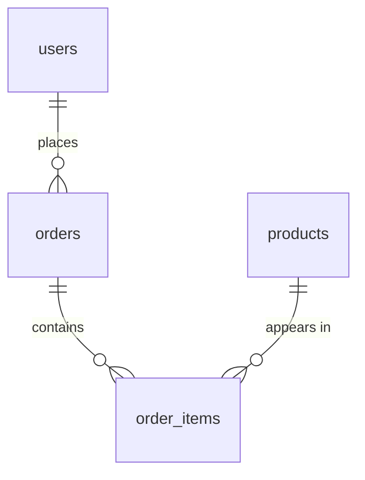

# E-Commerce Database (PostgreSQL)

A relational database that simulates the backend of an online store: customers, products, orders, and the items inside each order. Built with PostgreSQL on [Neon](https://neon.tech), and used to practice schema design and analytical SQL.

## Why I built it

Before building apps on top of a database, I wanted to understand the database itself: how tables relate to each other, how to ask real business questions in SQL, and why queries slow down. An e-commerce store is a good model because everyone already knows how it works: users buy products in orders.

## Schema

Four tables:

| Table | Description |
| --- | --- |
| `users` | Customer information |
| `products` | Product catalog with categories and pricing |
| `orders` | Order records linked to users |
| `order_items` | The individual items inside each order |



- A **user** can place many **orders**.
- An **order** can contain many **order items**.
- A **product** can appear in many **order items**.

`order_items` stores `price_at_purchase`, so changing a product's price later doesn't change the history of past orders.

## Queries

All queries are in [`queries.sql`](./queries.sql). They get progressively harder:

| # | Question it answers | Concept |
| --- | --- | --- |
| 1 | Show everything in each table | `SELECT` |
| 2 | Which user placed which order, and its status? | `INNER JOIN` |
| 3 | How many units of each product were ordered? | `INNER JOIN` |
| 4 | How much has each customer spent in total? | Multi-table join, `SUM`, `GROUP BY` |
| 5 | Which orders contain more than one item? | `GROUP BY`, `HAVING` |
| 6 | Which products sell the most? | CTE (`WITH`) |
| 7 | Which categories earn the most revenue? | Aggregation by category |

Example, total spent per customer:

```sql
SELECT u.full_name, SUM(oi.price_at_purchase * oi.quantity) AS total_spent
FROM users u
INNER JOIN orders o ON u.id = o.user_id
INNER JOIN order_items oi ON o.id = oi.order_id
GROUP BY u.full_name
ORDER BY total_spent DESC;
```

## Indexes

Indexes sit on the columns used most in joins and lookups ([`indexes.sql`](./indexes.sql)):

```sql
CREATE INDEX idx_orders_user_id ON orders(user_id);
CREATE INDEX idx_order_items_order_id ON order_items(order_id);
CREATE INDEX idx_order_items_product_id ON order_items(product_id);
CREATE INDEX idx_users_email ON users(email);
```

I used `EXPLAIN ANALYZE` to check that queries use Index Scans instead of Sequential Scans.

## What I learned

- **Schema design:** splitting data into tables with foreign keys instead of one giant table, and thinking about one-to-many relationships.
- **JOINs:** combining two or three tables to answer one question.
- **Aggregation:** `SUM`, `COUNT`, `GROUP BY`, and the difference between filtering rows (`WHERE`) and filtering groups (`HAVING`).
- **CTEs:** breaking a complex query into named steps with `WITH`, so it reads in order.
- **Indexing:** why indexes on foreign keys matter, and how `EXPLAIN ANALYZE` shows what the database is really doing.
- **Working with a hosted database:** setting up and using a serverless Postgres database on Neon.

<!-- Optional: add one thing that surprised you, for example a query that returned wrong totals until you fixed a JOIN. -->

## Files

| File | Purpose |
| --- | --- |
| `schema.sql` | Creates the tables and relationships |
| `seed.sql` | Inserts sample data |
| `queries.sql` | The analytical queries above |
| `indexes.sql` | Index creation |

## Setup

1. Create a free account on [Neon](https://neon.tech) and create a new project and database.
2. Open the SQL Editor and run `schema.sql` first.
3. Run `seed.sql` to insert the sample data.
4. Run `indexes.sql` to create the indexes.
5. Run any queries from `queries.sql`.

You can also run the files against any PostgreSQL database with `psql`.

## Author

**Adnan** — [@Adnan-Zhaikh](https://github.com/Adnan-Zhaikh)
